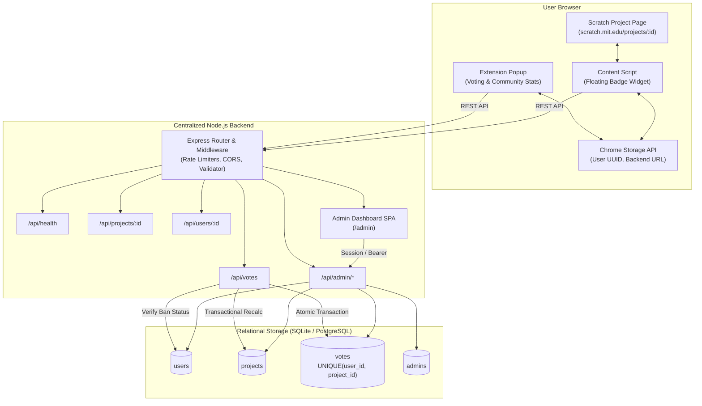
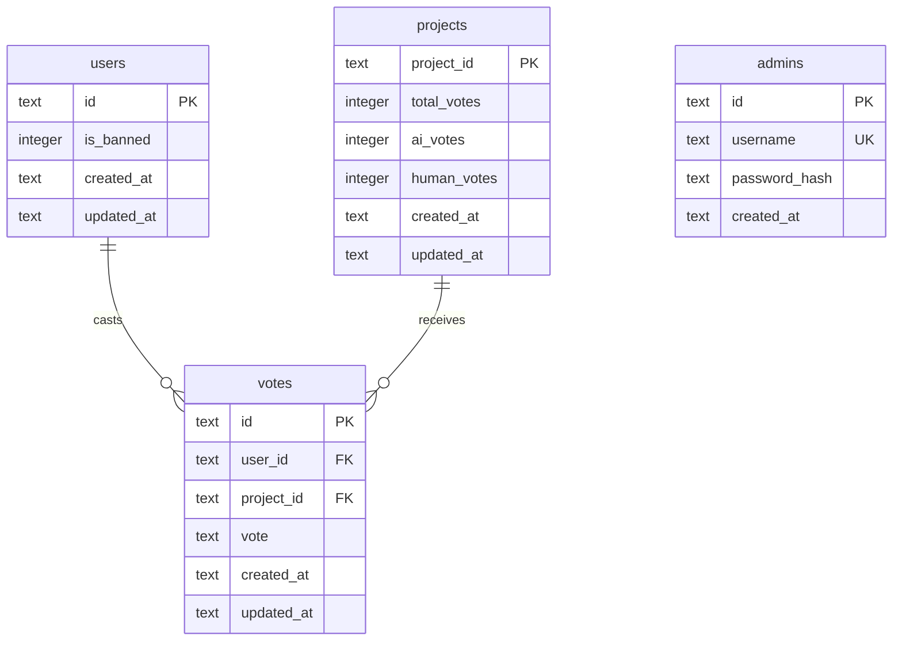

# Cao AI Detector – System Architecture

## 1. System Overview

Cao AI Detector is a community-driven AI detection platform for Scratch (`https://scratch.mit.edu/`). It pairs a lightweight Manifest V3 Chrome Extension with a centralized Node.js backend and an administrative moderation dashboard.



---

## 2. Component Design

### 2.1 Chrome Extension (Manifest V3)
- **Background Service Worker (`background/service-worker.js`)**:
  - Automatically provisions a random UUID v4 on first installation.
  - Monitors tab URL changes on `scratch.mit.edu` to display verdict indicators on the extension toolbar icon.
- **Popup (`popup/popup.html`, `popup.js`, `popup.css`)**:
  - Queries active tab to detect numeric Scratch project ID (`/projects/(\d+)/`).
  - Fetches project statistics and existing user vote from the backend.
  - Renders 🤖 AI-generated and 👤 Human-created buttons with active selection states.
  - Visualizes voting distribution with a progress bar and community verdict badge.
  - Fully supports dark and light modes.
- **Content Script (`content/content.js`, `content.css`)**:
  - Injected strictly into `scratch.mit.edu/projects/*`.
  - Displays a non-intrusive floating pill in the bottom right corner with isolated CSS classes (`cao-*`), allowing users to view verdicts or cast votes without opening the popup.
- **Options Page (`options/options.html`)**:
  - Configures backend URL, tests server connectivity, displays and copies UUID.

### 2.2 Backend Service (Node.js & Express)
- Modular layered structure:
  - `src/config.js`: Central environment configuration.
  - `src/db/database.js`: SQLite synchronization wrapper with WAL mode and transaction rollback support.
  - `src/middleware/validate.js`: Strict regex validation for Scratch project IDs (numeric digits) and user UUIDs.
  - `src/middleware/rateLimiter.js`: Sliding-window rate limiting to protect voting and admin login endpoints.
  - `src/middleware/auth.js`: JWT token verification and HTTP-only cookie parsing.
  - `src/services/verdict.js`: Core aggregation formula and verdict determination.

---

## 3. Database Schema & Data Integrity



### Critical Database Constraints:
1. `UNIQUE(user_id, project_id)` on the `votes` table guarantees at the database engine level that no user can cast more than one active vote on a project.
2. Foreign keys (`PRAGMA foreign_keys = ON;`) ensure integrity between votes and users/projects.
3. Vote updates and counter calculations are executed inside an atomic transaction:
   ```sql
   BEGIN IMMEDIATE;
   -- insert or update vote
   -- select actual counts:
   SELECT COUNT(*), SUM(vote='ai'), SUM(vote='human') FROM votes WHERE project_id = ?;
   -- update projects counter
   COMMIT;
   ```
   Recalculating from actual votes guarantees zero counter drift across concurrent requests, vote deletions, or user purges.

---

## 4. Voting Algorithm & Verdict Rules

The community verdict is determined by community vote proportions:

$$\text{AI percentage} = \left(\frac{\text{AI votes}}{\text{Total votes}}\right) \times 100$$

$$\text{Human percentage} = \left(\frac{\text{Human votes}}{\text{Total votes}}\right) \times 100$$

### Decision Table:
| Total Votes | AI % | Verdict | Reliability |
|---|---|---|---|
| `< 5` | Any | `Insufficient data` | Not reliable (below threshold) |
| `≥ 5` | `> 50%` | `AI-generated` | Reliable community verdict |
| `≥ 5` | `< 50%` | `Human-created` | Reliable community verdict |
| `≥ 5` | `== 50%` | `Undetermined` | Reliable community verdict |

---

## 5. Security Model

1. **Password Hashing**: Admin passwords stored with standard salted bcrypt hashing.
2. **Session Cookies**: Admin authentication uses HTTP-only `SameSite=Lax` cookies, with Bearer header fallback.
3. **No Account Requirement for Voters**: Voters remain pseudonymous with client-side UUIDs stored in `chrome.storage.local`.
4. **Rate Limiting**: Protects against automated vote manipulation and brute-force authentication.
5. **Admin Isolation**: Admin passwords and tokens are never exposed to the Chrome extension.
